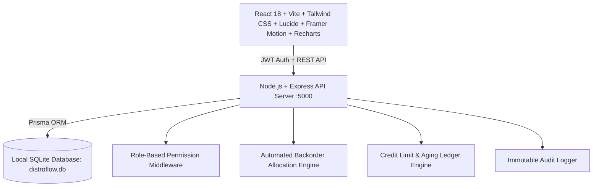

# DistroFlow — Distributor–Retailer Supply Chain CRM Platform

DistroFlow is an end-to-end, enterprise-grade B2B distribution CRM platform built to model real-world supply chain distribution houses. Inspired by the clean, purposeful 18-step onboarding and workspace design from the beehiiv web flow on Mobbin, DistroFlow pairs a disciplined, high-density UI with strict 6-role organizational RBAC, automated backorder splitting, credit-limit-aware ordering, accounting ledgers, and delivery fleet routing.

---

## 1. Problem Statement & Evaluator Narrative

> "DistroFlow solves a real distribution-chain problem: a distributor doesn't run this business alone — they employ sales executives, warehouse staff, accountants, and delivery personnel, each needing different access and accountability. Most CRM projects flatten this into a single admin login; DistroFlow models the real org structure with role-based access control, per-staff performance tracking, and a full audit trail. On top of that, it solves two concrete business problems: lost sales from rejecting out-of-stock orders (solved via automatic backordering) and payment risk (solved via credit-limit-aware order approval). The result feels like software a real distribution business would actually adopt, not a toy CRUD app."

---

## 2. Multi-Role Org Chart (Strict Backend RBAC)

```
                       ┌─────────────────────────┐
                       │   Distributor (Owner)   │
                       │   Full Org & Financials │
                       └────────────┬────────────┘
                                    │
       ┌───────────────┬────────────┴───────────┬────────────────┐
       ▼               ▼                        ▼                ▼
┌─────────────┐ ┌──────────────┐       ┌─────────────────┐ ┌───────────────┐
│ Sales Exec  │ │  Warehouse   │       │   Accountant    │ │Delivery Fleet │
│ Zone Orders │ │  Pack Queue  │       │  Aging Ledgers  │ │Mobile Manifest│
│ Commissions │ │ Stock Restock│       │ Collections/Risk│ │Swipe-to-Deliv │
└──────┬──────┘ └──────────────┘       └─────────────────┘ └───────┬───────┘
       │                                                           │
       └────────────────────► ┌───────────────┐ ◄──────────────────┘
                              │   Retailer    │
                              │ B2B Storefront│
                              │ Auto-Backorder│
                              └───────────────┘
```

| Role | Responsibilities | Security Boundary |
| :--- | :--- | :--- |
| **Distributor (Owner)** | Full control, hiring staff, commissions, margins, AI forecast, audit trail. | Unrestricted |
| **Sales Executive** | Manages assigned zone retailers, books field-visit orders, tracks 2.5% commission. | Cannot view unauthorized zones or alter base prices. |
| **Warehouse Manager** | Live stock counts, manages Pack Queue, marks orders "Packed". | Cannot view profit margins or payment ledgers. |
| **Accountant** | Enters payment collections (UPI/Cash/NEFT), manages aging debt (0-90+ days). | Cannot adjust physical stock or alter retail zones. |
| **Delivery Person** | Mobile-optimized route view: today's assigned drop-offs, 1-click "Mark Delivered". | Only sees retailer addresses and carton counts. |
| **Retailer** | Self-serve store catalog, cart with credit-check, automatic backorder splits, invoices. | Isolated to own store orders and statements. |

---

## 3. Architecture & Tech Stack



* **Frontend**: React 18, Vite, Tailwind CSS, Lucide React (disciplined icon usage), Recharts, Framer Motion.
* **Backend**: Express.js REST API with JWT authentication and `verifyRoles([...])` middleware.
* **Database**: SQLite via Prisma ORM (`prisma/schema.prisma` -> `prisma/distroflow.db`). Zero external database configuration required.
* **Seed Dataset**:
  * 6 staff accounts across Sales, Warehouse, Accounts, and Fleet + Admin + Retailer
  * 15 realistic retail stores across North, South, East, West, Central zones
  * 30 categorized products with live stock, tax rates, and warehouse bay locations
  * 50 orders spanning Placed, Confirmed, Packed, Dispatched, Delivered, and Backordered statuses
  * Complete payment transactions and immutable audit logs.

---

## 4. Key Differentiators & Business Logic

### A. 18-Screen Inspired Onboarding Flow (Beehiiv Design)
* **5-Step Setup Wizard**: Legal Entity & GSTIN &rarr; Territory Hubs &rarr; RBAC Team &rarr; Credit Risk &rarr; Backorder Engine.
* **Interactive Dashboard Checklist**: Tracks onboarding completion right inside the distributor dashboard.
* **Update Announcement Modal**: Informs users about engine upgrades and new dispatch features.

### B. Intelligent Out-of-Stock Handling (Automated Backorders)
When a retailer or sales executive orders an item with insufficient warehouse stock:
1. The available inventory is fulfilled and decremented.
2. The remaining requested quantity is automatically split into a linked **Backorder / Pre-order**.
3. Priority restock notifications are routed to the warehouse manager and distributor.
4. When new stock is received via inbound PO, the engine prioritizes pending backorders.

### C. Credit-Limit Enforced Checkout
Every order calculates `Current Outstanding + New Order Total`. If it exceeds the store's credit limit, checkout is blocked with an explicit debt notification, protecting the distributor against bad debt.

### D. 1-Click Evaluator Persona Switcher
The top bar features a pill-based persona switcher. Evaluators can click between **Distributor**, **Sales Executive**, **Warehouse Manager**, **Accountant**, **Delivery Staff**, and **Retailer** to immediately experience how the UI and backend permission gates adapt in real-time.

---

## 5. Quick Start & Running Locally

### Step 1: Install Dependencies & Setup Database
```bash
npm install
npx prisma db push
npx tsx prisma/seed.ts
```

### Step 2: Start Fullstack App (Concurrently)
```bash
npm run dev
```
* **Frontend Web App**: `http://localhost:3000`
* **Backend Express API**: `http://localhost:5000`

### Pre-Configured Demo Accounts (Password: `password123`)
* **Distributor (Owner)**: `owner@distroflow.com`
* **Sales Executive**: `sales.rohit@distroflow.com`
* **Warehouse Manager**: `warehouse.anil@distroflow.com`
* **Accountant**: `accounts.priya@distroflow.com`
* **Delivery Person**: `delivery.deepak@distroflow.com`
* **Retailer**: `retail.apex@quickmart.in`
*(Or simply click any role in the top switcher bar!)*
