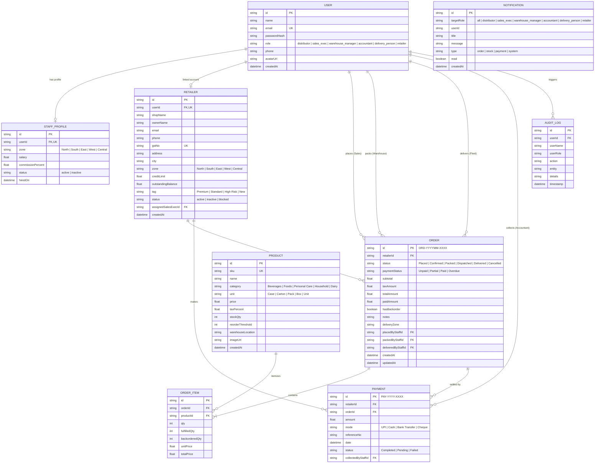
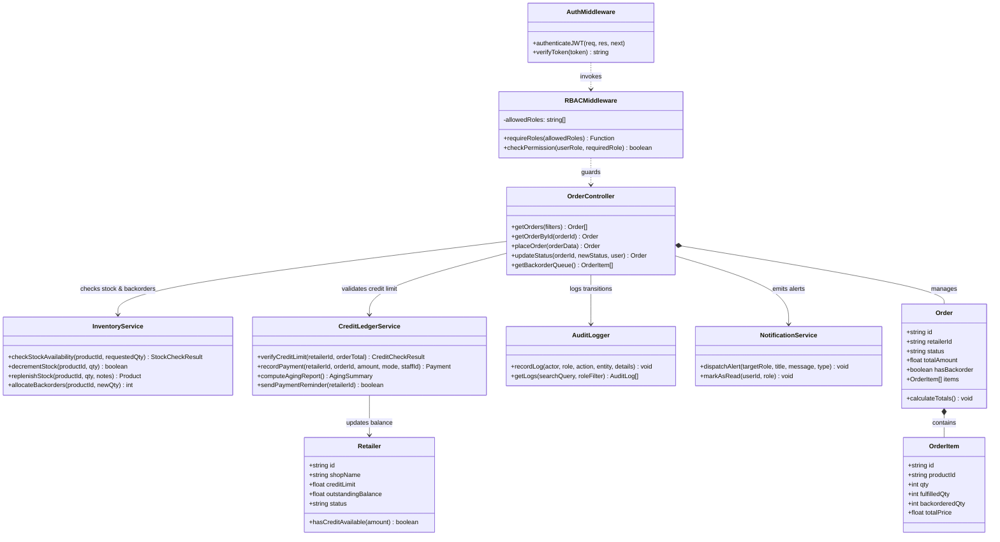
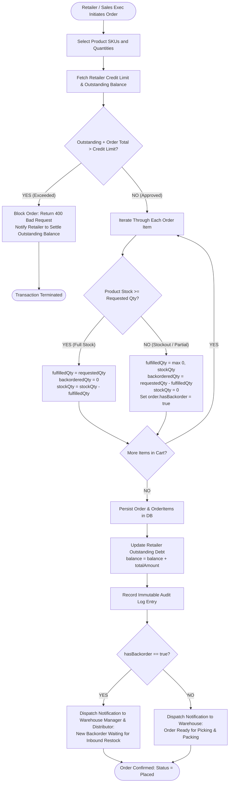
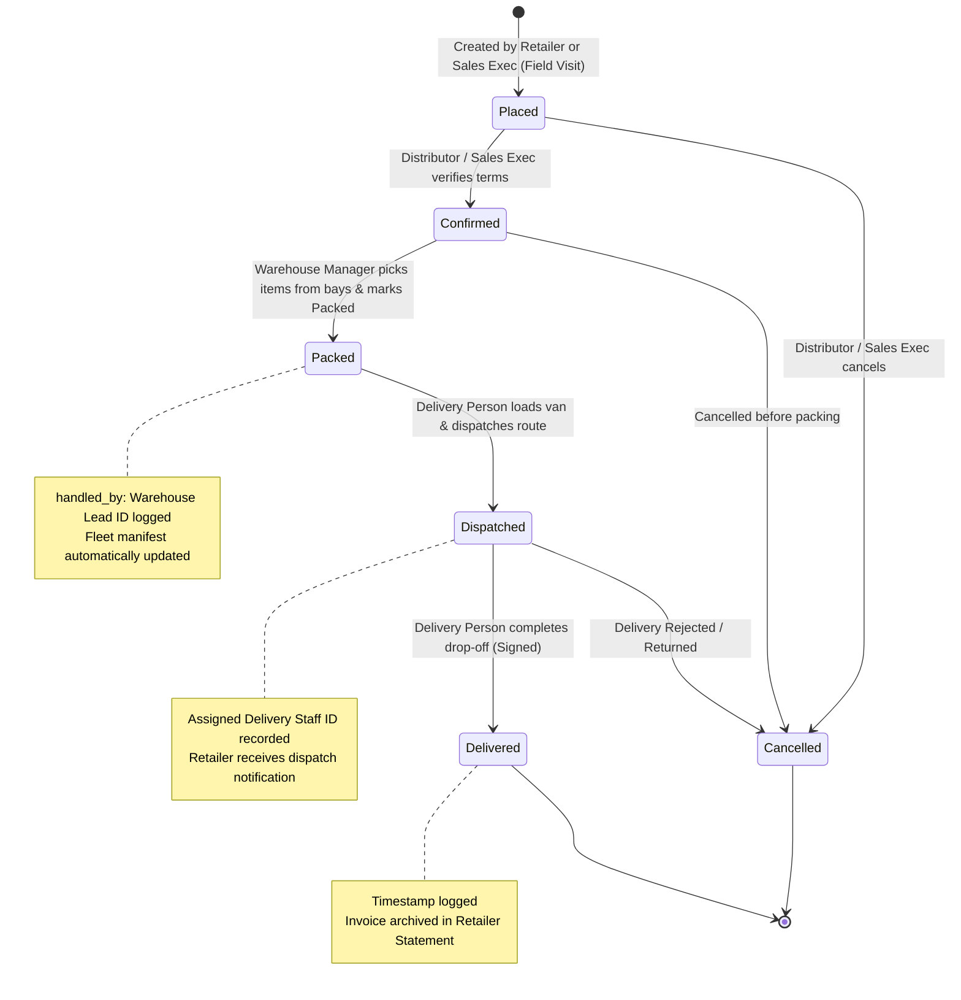
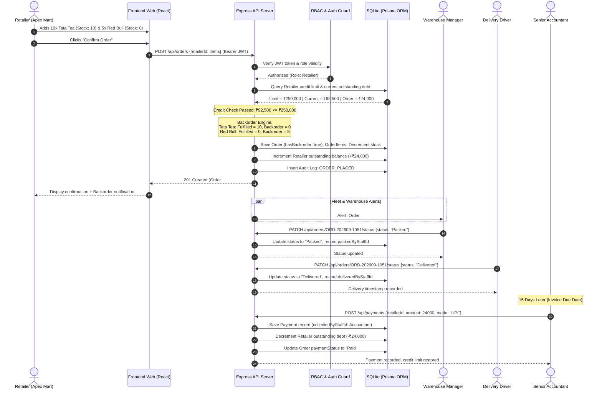
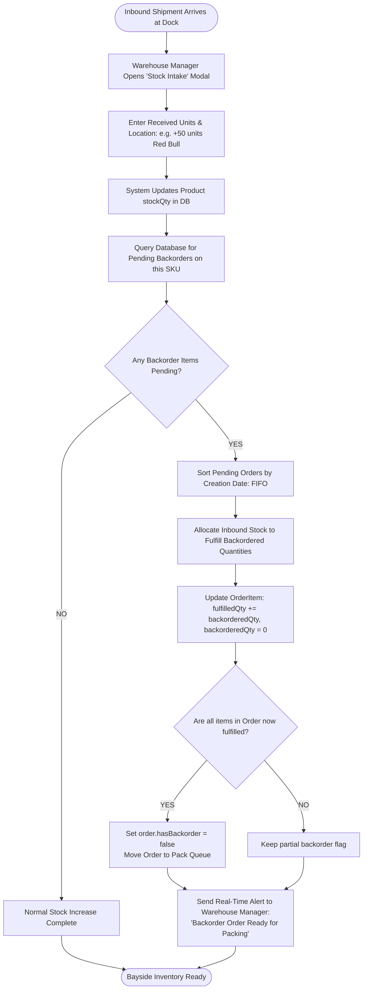

# DistroFlow CRM — Complete UML & System Architecture Diagrams

This document provides production-grade UML diagrams modeling the complete architecture, data models, state machines, and business workflows of the **DistroFlow** platform. All diagrams use standard Mermaid syntax and are ready to be included directly in project documentation, evaluation reports, or thesis papers.

---

## Table of Contents
1. [Entity-Relationship (ER) Diagram](#1-entity-relationship-er-diagram)
2. [Class Diagram (Object-Oriented Architecture)](#2-class-diagram)
3. [Core Flowchart: Order Placement & Automated Backordering](#3-core-flowchart-order-placement--automated-backordering)
4. [State Machine Diagram: Order Fulfillment Pipeline](#4-state-machine-diagram-order-fulfillment-pipeline)
5. [Sequence Diagram: End-to-End Order & Credit Lifecycle](#5-sequence-diagram-end-to-end-order--credit-lifecycle)
6. [Activity Diagram: Inbound Restock & Backorder Allocation](#6-activity-diagram-inbound-restock--backorder-allocation)

---

## 1. Entity-Relationship (ER) Diagram

Represents the physical SQLite database schema managed through Prisma ORM. Models strict primary-to-foreign key relationships, cascade rules, and role associations.

---

## 2. Class Diagram

Illustrates the object-oriented structure of the backend application, showing controller services, middleware security wrappers, and database models.

---

## 3. Core Flowchart: Order Placement & Automated Backordering

Visualizes the core algorithmic logic of DistroFlow: how credit risk is mitigated and how zero/insufficient inventory is automatically split into backorders without rejecting the sale.

---

## 4. State Machine Diagram: Order Fulfillment Pipeline

Models the lifecycle of an order and which organizational role owns each stage transition. Unauthorized roles attempting transitions are blocked by backend RBAC middleware.

---

## 5. Sequence Diagram: End-to-End Order & Credit Lifecycle

Tracks interactions across system boundaries from store order creation to warehouse packing, delivery dispatch, and accountant payment reconciliation.

---

## 6. Activity Diagram: Inbound Restock & Backorder Allocation

Illustrates how inbound shipments automatically satisfy queued backorders without requiring manual re-entry.

